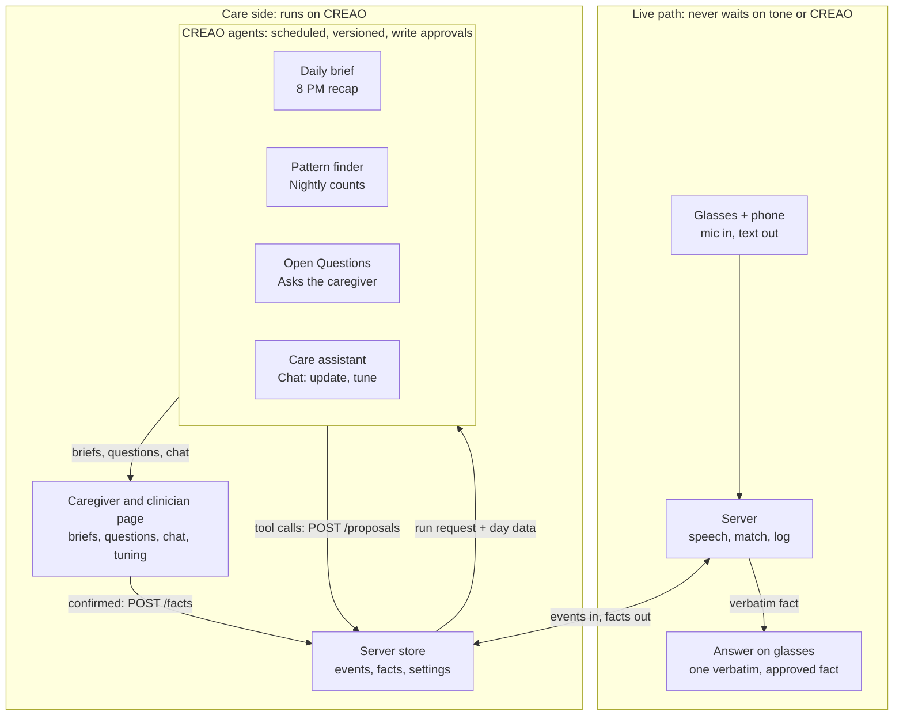
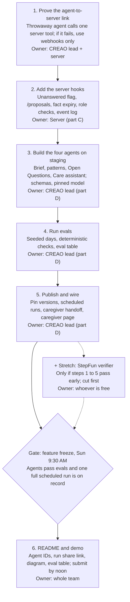

# Care-Side Agent Platform: Build, Measure, Evaluate

Oct 17, 2026 · Nam Mai

## Purpose and scope

The glasses answer in the moment; the care side is where the caregiver learns what to do about the questions behind those moments, and a CREAO agent harness is what makes that side run without us building the plumbing. The wearer is a person in the early stage of dementia or Alzheimer's; caregivers and clinicians are the supporting users.

**What the care side is.** Everything that happens off the live path: a nightly brief for the caregiver, pattern detection across days, and an Open Questions agent that picks out the questions the glasses could not answer and asks the caregiver to answer them. None of it touches what the wearer sees until a human publishes a fact.

**Why CREAO is vital here, not decorative.** CREAO gives us scheduling, connectors, write approvals and dashboards out of the box. Without it we would hand-build a cron service, an approval queue, a notification channel and a review UI. With it, the agents *are* the care loop: remove them and the caregiver gets no brief, no open questions and no way to update the plan by talking, so the glasses slowly go stale.

**In scope for the event:** brief agent, pattern agent, Open Questions agent, Care assistant, a small eval harness, signal logging on the server, and a StepFun verifier slot as a stretch.

**Out of scope:** diagnosis, clinical scoring, anything the wearer sees that a model wrote, and the other seven modules in the full product spec.

**Hard rules carried over from the MVP spec:** the live path never waits on tone or CREAO; answers shown on the glasses are verbatim, caregiver-approved facts; we describe patterns and never diagnose; keys stay server-side.

## Architecture

The live path is the glasses, phone and server only; the care side hangs off the server's store and talks to it in both directions.

The server triggers CREAO runs through the API and receives results by webhook. Agents can also call server tools such as POST /proposals, if the 10-minute sandbox test passes; if it fails, the server pushes the day's data in and pulls results out, and the Open Questions agent's results arrive by webhook instead. Either way the two highlighted agents, Open Questions and the Care assistant, never publish: a caregiver confirms the wording, and only then does POST /facts change what the glasses can say.

## The agents

Four saved CREAO agents do the care work, each with a fixed input form, a fixed output schema, pinned model and a published version; the earlier 5-minute log agent is dropped as an agent and stays plain server code.

| Agent | Trigger | Reads | Produces | Write autonomy |
| --- | --- | --- | --- | --- |
| Daily brief | Scheduled 8 PM, plus server run on demand | Day's question events, match decisions, tone records, fact list | Summary JSON (date, summary, repeatedQuestions, highlights, suggestions, coverage, sources) and a dashboard page | Auto for the brief; Slack or email handoff to caregivers |
| Pattern finder | Scheduled nightly, after the brief | Last 7 to 14 days of briefs and events | Patterns such as repeat times of day and topic clusters, each with counts and source IDs | Auto; read-only on the server |
| Open Questions | Scheduled nightly, plus run when a question is flagged unanswered | Questions that passed the server noise filter; existing facts | Open questions sent to POST /proposals: question cluster, event IDs behind it and a blank answer, after the noise filter | Ask first: the caregiver writes or approves the answer; only a human publishes through POST /facts |
| Care assistant | Chat from a caregiver or clinician; the server starts the run and passes the person's role | The request, current facts and settings, recent briefs | Caregiver: exact fact wording and a valid-until time to confirm. Clinician: a settings change with a replay preview | Ask first for facts (confirmed outside the run); settings saved as a new version; the server checks the role on every write |

**Rules for every agent.**

- Numbers (counts, times, trends) are computed in code in the sandbox; the model only narrates them.
- Every claim cites event or fact IDs under `sources`; a claim without a source is dropped.
- Wording is descriptive: "asked 9 times between 3 and 5 PM", never "confused" or "declining".
- Output carries a `schema_version` so the server and dashboard can reject malformed runs.
- Models and versions are pinned and published, because CREAO falls back to Lite if a saved model becomes unavailable.

**Open Questions is the core loop.** The glasses abstain or miss, the question is logged as unanswered, the agent raises it as an open question, the caregiver writes the answer, the server publishes it as a fact, and next time the glasses answer. That loop is what makes removing the agent break the product.

**Noise filter.** Most unanswered or repeated questions should never reach the caregiver, so two layers screen them first.

- Server, before any agent runs: keep only wearer-attributed questions above a confidence threshold; drop fragments like 'what?' or 'huh'; skip questions an existing fact already answers or that already have a pending or dismissed open question.
- Agent: cluster similar questions with embeddings; raise one open question per cluster only if it repeats at least 3 times across at least 2 times of day (starting thresholds, to tune); cap at about 3 per day; suppress any cluster the caregiver dismisses as not useful.

**What an open question contains.** The question cluster, the evidence (event IDs, counts, times) and a blank answer for the caregiver to fill in. The agent never invents the answer; it may pre-fill one only when it comes from an existing fact.

**Optional midday check-in.** A second brief run at midday covers the day so far, lists open questions still waiting and is labelled partial through the `coverage` field. It reports no tone trends or repeat counts from a few hours of data, and the 8 PM run replaces it for that date, keyed by date and window. The server can also trigger an on-demand refresh at any time. Build the 8 PM brief and the on-demand refresh first; add the midday schedule only after the evals pass.

## Roles and change flow

Two kinds of people talk to the agents, and the server, not the agent, decides what each of them may change.

| Role | Talks to the agent to | Can change | Cannot |
| --- | --- | --- | --- |
| Caregiver (owner: family member or aide) | Update the plan, answer open questions, ask why something was raised | Wearer-facing facts, through wording they confirm; who has clinician access | Edit clinical measurement settings (can view them) |
| Clinician (invited and scoped by the caregiver) | Change how things are measured and reported | Measurement settings, saved as a new version | Publish or edit facts the wearer sees |

**Caregiver update flow.**

1. A caregiver tells the agent, for example 'I'm visiting Thursday at 3.'
2. The agent finds the existing fact on that topic and proposes a replacement, not a duplicate. If the request is ambiguous it asks, for example which Thursday.
3. It shows the exact wording the wearer will see and a valid-until time. The caregiver confirms with one tap, on the caregiver page or in Slack, outside the agent run, because API-started runs cannot pause for approval.
4. The server publishes that wording as written and re-indexes it, and the next matching question on the glasses uses it.

The caregiver page lives in the CREAO dashboard if it can take input and call our server; otherwise it is a small page on our server. The 10-minute test decides.

**Facts need an expiry.** Every fact carries a valid-until time. When it passes, the glasses stop giving that answer and the question returns to open questions. The agent asks for a valid-until time when the caregiver does not give one.

**Clinician tuning flow.**

1. The clinician asks in plain language, for example 'count a question as repeated after 2 asks within an hour'.
2. The agent turns it into a settings change from a fixed list of allowed parameters: repeat thresholds, time windows, topic filters, report sections, tone on or off. It never edits its own instructions.
3. The server replays the new settings on past days and shows a before-and-after preview.
4. On accept, it is saved as a new settings version labelled with the clinician's name and time, and one click reverts it. Every later run reads the current version through its input form.

Tuning never touches the live path, the wording rules or the citation requirement. The measures stay counts, times and the tone trend, with no composite score that could be read as clinical. A clinician's settings are preferences, not validated clinical logic, and are labelled that way.

**Enforcement.** Every request to an agent carries who is asking and their role. The server checks the role on each write and rejects a clinician call to POST /facts or a caregiver call to the settings endpoint, so permissions never depend on agent instructions.

**Why an agent and not a form.** A form could update the visit fact. The agent adds parsing of plain speech, finding the fact to replace, setting the valid-until time, asking follow-up questions and turning a clinical request into bounded settings with a preview. Without it the caregiver is back to filling in forms, which is the remove-the-agent test the CREAO track applies.

**Sharing with the clinician.** The pattern finder's weekly run can also prepare a visit summary: question counts, times of day, topics and what has been answered, in the same descriptive wording as the brief. The caregiver decides whether to share it, and any send is ask-first. Tone is excluded unless the caregiver turns it on. This is a stretch output; for the event the clinician is a mock login on demo data, and a dedicated clinician-facing agent comes after we ask a clinician what they need.

## Signals to collect

Every stage of the pipeline writes one small structured event, so the agents and the evals have something real to read; log IDs and scores, not raw audio.

| Stage | Signal to log | Why we need it |
| --- | --- | --- |
| Glasses and phone | Answer displayed, dismissed, re-requested, paused; connection drops | Tells us whether an answer was useful or ignored |
| Speech | Attributed role (wearer or other), confidence, transcript segment length, abstentions, end-to-end latency | Checks wearer attribution and the ~2 s budget |
| Matching | Cosine score, yes/no check result, matched fact ID, unanswered flag, wrong-match reports | Feeds Open Questions and the matcher eval |
| Tone | Provider, scores, top label, worry flag, quality, only on wearer questions | Trend input for the brief; never shown on glasses |
| Caregiver and clinician | Fact create, edit, delete; open question answered, edited, dismissed as not useful; brief opened; thumbs rating; who made each change; assistant requests, confirms and abandons; settings versions | The real effectiveness signal for the agents |
| Agents | Run ID, version, model, duration, credits, failure reason, schema validity, citation coverage | Reliability and cost over time |

**Rules.** Each event carries a timestamp, a stable event ID and a `schema_version`. The unanswered flag and a `POST /proposals` endpoint are the two new server pieces the Open Questions agent needs. Tone and agent data never block the live path.

## Metrics, ratings and success criteria

We judge the care side on whether the caregiver acts on what the agents produce, not on how fluent the output sounds; the targets below are proposed starting thresholds for the event, to be tuned once we see real runs.

| # | Metric | How it is measured | Proposed target |
| --- | --- | --- | --- |
| 1 | Brief accuracy | Counts and times in the brief match the code-computed numbers on seeded days | 100% of numbers match |
| 2 | Citation coverage | Share of claims with a valid event or fact ID | 100%, uncited claims dropped |
| 3 | Banned wording | Diagnostic phrases found in any output | 0 |
| 4 | Schema validity | Runs that pass the output schema | At least 95% of runs |
| 5 | Pattern recall | Planted patterns the pattern agent finds on seeded days | At least 4 of 5 |
| 6 | False pattern rate | Patterns reported on sparse or negative days | 0 |
| 7 | Open-question answer rate | Open questions the caregiver answers, versus dismisses as not useful | Tracked; aim to rise across the weekend |
| 8 | Question closure | Questions that were unanswered, then answered after a published fact | Tracked per day |
| 9 | Caregiver usefulness | Thumbs or 1 to 5 rating on each brief | Tracked, with a free-text reason |
| 10 | Run reliability and cost | Failures, retries, credits per day | Zero missed scheduled runs in the demo window |
| 11 | Stale answers | Facts served to the wearer after their valid-until time | 0 |
| 12 | Update round trip | Time from the caregiver's confirm to the glasses using the new wording | Tracked; starting target under 1 minute |
| 13 | Role enforcement | Cross-role writes rejected in tests (clinician publishing a fact, caregiver changing clinical settings) | 100% rejected |

**How we rate.** Automated checks (rows 1 to 4) gate every published agent version. Seeded-day checks (rows 5 and 6) run before each version. The update and role checks (rows 11 to 13) also gate every version. Human ratings (rows 7 to 9) come from the caregiver page and are the only ones we call evidence of usefulness. All outcomes stay descriptive, never clinical.

## Evals and sandboxing

Yes, we need a small eval harness and a separate staging copy of each agent, because caregivers will rely on these outputs and an agent that drifts silently is worse than no agent. For the weekend this can be small; for the long run it is the thing that tells us whether the agent keeps working.

**Sandbox.** Keep a staging agent (same instructions, test input form, fake data only) apart from the published demo agent. Edit and test on staging, then publish and pin a new version. Seeded data never goes through the real caregiver account.

**What to run before each published version.**

1. Seeded days: five days with a planted pattern (for example a repeated 3 to 5 PM question) and two sparse or negative days with no pattern, one of them full of chatter that must produce no open questions.
2. Deterministic checks: schema valid, every number equals the code-computed value, every claim has a real source ID, no banned diagnostic phrases.
3. Negative cases: the agent must say "not enough data" on sparse days and must not invent a pattern.
4. Open Questions cases: a repeated unanswered question yields an open question that cites its event IDs; an already-answered question, one-off chatter or a previously dismissed cluster yields none. Care assistant cases: 'visiting Thursday at 3' replaces the existing visit fact, sets a valid-until time and asks which Thursday if the date is ambiguous; a clinician request to publish a fact, or a caregiver request to change clinical settings, is rejected by the server.
5. Record version, model, pass rate and cost in a short eval table for the README.

**What to run over the long term.** These need real use, so they start after the event.

- Caregiver answer, edit and dismissal rate for open questions, and brief ratings, trended weekly.
- Repeat-question coverage: share of repeated questions that end up with a published answer.
- Replay the same seeded and real (consented) days whenever the model, version or instructions change, and compare to the last passing run.
- Cost per day and run failure rate, so a quiet regression shows up as a number.

**Limit.** Evals show the agent is consistent and cited; only caregiver behaviour shows it is useful. We will not claim clinical benefit from either.

## Build plan, owners and cut order

The care side is built in order, with the link test first because it decides whether agents call the server or only receive triggers from it.

Steps 1 to 5 run one after another for the CREAO lead; the server hooks in step 2 can start as soon as step 1 says which integration style we use.

**Cut order when time runs short.**

1. The StepFun verifier, the visit summary and the midday brief.
2. Pattern agent polish: keep a simple version that reports counts only.
3. Dashboard styling and natural-language clinician tuning (ship a plain settings form first).
4. Never cut: the Open Questions loop, the caregiver update flow through the Care assistant, the brief evals, and the README links to agent IDs and a run share link, because the CREAO track checks them.

## StepFun stretch goal

StepFun's Step 5 Preview slots in as an independent verifier of what the CREAO agents produce, never on the live path, because its first-token latency (about 3.2 s p50 on StepFun) is over our 2 s budget. Only attempt it once the four agents and the eval harness pass.

**Role.** After the brief or a proposal is generated, the server sends the draft, the cited events and the facts to `step-5-preview` and asks one question: is every claim supported by the sources, and is any wording diagnostic?

**Output.** A verdict per claim (supported, unsupported, diagnostic wording) with the offending text. Flagged items get a "needs review" badge on the caregiver page and are held back from the proposals queue until a human looks.

**Why it fits the StepFun track.** The track judges task completion, reliability and how well the user can understand and control the result; a second model checking the first, with the caregiver still deciding, speaks to all three.

**Constraints.**

- The call is server-side with the key kept on the server, and uses demo data only.
- The verifier must call `step-5-preview` at runtime; it is not a swap-in for the live matcher.
- Budget about 1 to 2 hours; the first thing cut if the schedule slips.
- Its flags feed the same eval table: agreement rate between the verifier and our deterministic checks.

## Risks, safety and privacy

The biggest build risk is that the CREAO sandbox cannot call our server; the biggest product risk is an agent saying something that sounds like a diagnosis.

| Risk | Mitigation | Fallback |
| --- | --- | --- |
| Agent sandbox cannot reach our server | Test a tool call from a throwaway agent in the first 10 minutes | Server triggers runs and receives results by webhook; agents never call in |
| Agent output drifts or breaks schema | Pin model and version, validate schema on the server, reject bad runs | Show the last good brief with a stale marker |
| Diagnostic or alarming wording | Banned-phrase check, descriptive-only instructions, optional StepFun verifier | Hold the output for human review |
| Wrong or unsafe proposed fact reaches the wearer | Ask-first approval; only a human publishes via POST /facts; answers shown verbatim | Caregiver can delete a fact at any time |
| Scheduled run missed or auto-paused | Check run history before the demo; scheduled runs need Pro Plus or higher, which the hackathon account has | Trigger runs from the server |
| Wrong speaker attribution pollutes the data | Log attribution confidence; tone only on wearer questions | Drop low-confidence events from agent input |
| Privacy of a person with dementia | Demo data only; no raw audio sent to CREAO; keys server-side; access for the caregiver and an invited clinician only | Delete-all control on the server |
| Agent misparses an update (wrong day or time) and the wearer hears it | Show the exact wording back; a caregiver confirms; every fact carries a valid-until time | One-tap delete; the question returns to open questions |
| Role limits depend on the agent's instructions | Server checks the role on every write; cross-role tests in the eval set | Disable the clinician login for the demo |

**Safety stance.** The product describes, never diagnoses; it shows trends, not absolute scores; and a human decides every change to what the wearer sees.

## Open questions and roadmap

These questions need an answer from the team before the agents are final; the roadmap is what we keep building after the event, which is also what the CREAO Team Empowerment track asks for.

**Open questions.**

- [ ] Can a CREAO agent call our server's tools from its sandbox, or do we use webhooks only? (10-minute test)
- [ ] Who on the team owns the CREAO agents, the eval harness and the server endpoints?
- [ ] Do we add the unanswered flag and POST /proposals before the freeze, or demo Open Questions against a seeded queue?
- [ ] Do we attempt the StepFun verifier, and who does it if the core agents are done early?
- [x] Main user: the patient in the early stage of dementia or Alzheimer's; caregivers and clinicians are the supporting users. Pitch wording comes later.
- [ ] Does the caregiver page live in the CREAO dashboard, or on our own server page? (decided by the 10-minute test)
- [ ] Do we show a mock clinician login in the demo, and what single tuning request do we demo?

**After the event.**

1. Run the agents on consented real use, and trend acceptance and rating weekly.
2. Add contributor roles (other relatives, aides) and per-patient agent settings.
3. Replay evals on every model or version change, and track cost per patient per day.
4. Revisit the other modules in the full product spec once the care loop shows caregiver value.
5. Consider a fine-tuned small verifier model for the "same question?" check, which would also fit the veri.studio track.
