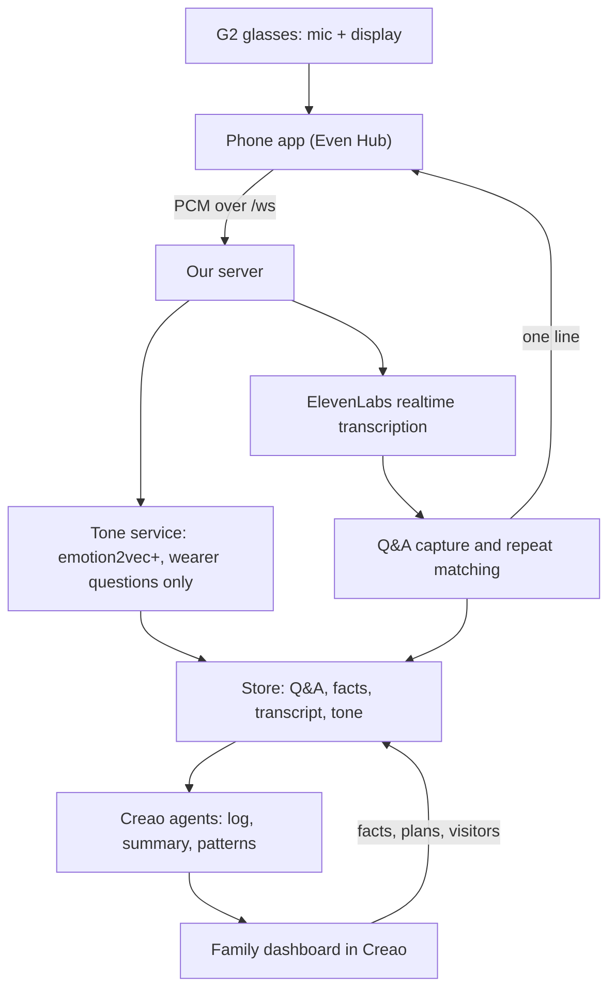

# Asked & Answered / Rewind — MVP implementation spec

Version 4.2 · 17 October 2026 · Hackathon edition (corrects v3.0; tone uses emotion2vec+; v4.2 changes in section 2b)

## 1. Scope

Build what can be demoed on a real Even G2 by **feature freeze, Sunday 9:30 AM**. Submissions close at noon.

The product: G2 glasses quietly answer the questions a person with early dementia keeps repeating, using answers their family already gave. The family sees what happened through a Creao dashboard, including the estimated tone of the wearer's voice.

**In scope (must work in the demo)**

1. G2 audio → live transcription → question and answer capture → repeat matching with a yes/no check → one sourced line on the glasses.
2. Family facts, today's plan and visitors entered in the Creao dashboard and used as fallback answers.
3. Voice tone: estimated tone of each wearer question, using the open-source emotion2vec+ model in our own Python tone service.
4. Creao agents: log, daily summary and patterns, built from the transcript **and** tone estimates.
5. Pause, gestures, system exit and recovery after a five-minute phone lock.

**Stretch, in this order, only if 1–5 work on hardware:** wearing and battery alert → reminders (simple version) → patterns over seeded history.

**Out of scope for the hackathon:** see section 10. These go in the Devpost as future work.

Each person reads the build guide for their part; this spec changes it where noted.

## 2. Corrections from v3.0

| v3.0 said | Problem | v4.0 |
| --- | --- | --- |
| ElevenLabs required, loudness insufficient | ElevenLabs realtime has no speaker labels, so with no loudness there is no way to find the wearer | ElevenLabs Realtime with calibrated loudness, abstain when unsure. Deepgram with speaker labels stays a switchable fallback |
| Device `speakerRole`/direction hints | Not in the Even SDK docs: audio events carry only the PCM and the source (glasses or phone) | Removed. Ask the Even table about mic-array features; don't depend on them |
| Everything required, including stretch | Weeks of work | Must-haves and stretch separated; production items moved to future work |
| Two-day patterns working unattended | Only one day of data exists | Patterns run on seeded history plus today, clearly labeled as demo data |
| Emotion "optional" with an open-ended provider search | Unscoped; Hume needs an approval form | emotion2vec+ (open source) in a Python tone service, wearer questions only, family dashboard only |
| Nine extra modules in another spec | A second project | Future work |
| v2 binary audio protocol | Changes both ends during the hackathon | Keep contract 1 (v1). Raw PCM frames as today |
| SQLite migrations, socket tickets, household auth, CSRF, idempotency, SSE | Production hardening | JSON store and shared secrets. Future work |

## 2b. Changes in v4.2 (from the code review)

| Change | Section | Who it affects |
| --- | --- | --- |
| Speech module sends an explicit `role`; only `other` speech can be an answer | 5, 6.4, 9 | B, C |
| An answer must actually reply to the question (yes/no check) before it is saved; if not, the answer window stays open for the next `other` line | 6.4, 9 | B, C |
| Matching has a hard deadline: target 0.8 s, gives up at 2 s; tighten after measuring on the venue network | 6.2 | C |
| End-to-end promise: about 2 s typical, at most about 3 s. A new question closes the previous answer window; the earliest-spoken reply wins. Overlap isn't guaranteed to be detected: unclear speech is `unknown` | 5, 6.4, 12 | B, C |
| Contradiction rule made concrete (**proposed, team to confirm**) | 6.3 | C |
| Server closes a connection that goes 45 seconds without audio or a ping; phone re-sends pause after reconnecting | 4, 9 | A, C |
| Audio clock counts every byte, including silence that isn't sent to the provider | 5 | B |
| Creao webhook carries its secret in the URL | 8, 9 | C, D |
| Summaries and "today" use the wearer's local date, not UTC | 8 | C, D |
| Reminders: delivery window and missed state (stretch only) | 6.7 | C, A |

## 3. Architecture



Rules that hold everywhere:

- **The live path never waits on the tone service or Creao.** If either is slow or down, answers still reach the glasses.
- **Answers are verbatim.** The matcher and verifier only choose or reject an existing answer. No model writes what the wearer sees.
- **Keys stay on the server.** The phone app holds only the app token.

## 4. Glasses and phone (A)

- Create the G2 startup page before starting the glasses mic. Forward PCM chunks to `/ws` (contract 1).
- Display is blank by default. One line: *answer, speaker, time*, or *answer (told you at time)* without a name. Clear after 8 seconds or on `clear`.
- **Never cut off a negation or instruction when shortening.** If an answer doesn't fit, show the first sentence only if it keeps its meaning; otherwise show "See phone" and the full text on the phone.
- Gestures: tap dismisses, **swipe up recalls the last answer**, long press pauses or resumes, **double tap on the root page is system exit** (Even requirement).
- Pause stops forwarding immediately and stops the mic. Recovery after reconnect never undoes a deliberate pause.
- Reconnect with 1, 2, 4, then 10 second backoff; ping every 15 seconds. The server closes a connection that sends nothing (no audio, no ping) for 45 seconds, so a locked phone doesn't keep a paid transcription stream open; the app simply reconnects when it wakes.
- After every reconnect, send `hello` and then, **if the wearer had paused, send `pause` again straight away**. The server treats each connection as listening until told otherwise.
- Verify manifest permissions, network whitelist, CORS, `.ehpk` packaging, and the installed Beta after a five-minute phone lock.

## 5. Speech (B)

- **ElevenLabs Scribe v2 Realtime** for live transcription, chosen by the loudness test. Only final (committed) text goes to matching.
- **Wearer attribution:** RMS loudness per utterance against a threshold calibrated on the real G2 with the wearer and a companion. Result is `wearer`, `other` or `unknown`. B marks anything it can't attribute confidently as `unknown`, including overlapping voices when it can tell; with ElevenLabs and loudness alone, overlap detection isn't guaranteed. `unknown` speech is never treated as a question or an answer.
- Each utterance carries: ID, text, start and end in milliseconds, RMS, **`role` (`wearer`, `other` or `unknown`), set by B**, and the name if known. The server uses `role` as given and never guesses it from speaker labels, because ElevenLabs sends none.
- Keep the `fake` provider for testing and Deepgram as a switchable fallback (`SPEECH_PROVIDER`).
- Report each utterance's `startMs` and `endMs` from the session's first audio byte. **Count every byte passed to `pushAudio`, including silent chunks you choose not to forward to the provider**; provider timestamps must be converted to this clock. The server keeps its own 60-second audio buffer and cuts each wearer question's audio from it by those times for tone analysis, so B doesn't store audio.
- Ask ElevenLabs (or Deepgram, with `punctuate=true`) for punctuation; question detection relies on the trailing "?" and question words.

## 6. Memory and matching (C)

1. A final wearer question is matched immediately against today's records and family facts.
2. Matching: embeddings and cosine similarity, a strict threshold tuned on the 20 match and 10 non-match fixtures (zero wrong matches first), then a yes/no check by a fast model. **Deadline: target 0.8 s (the build guide's budget: about 1 s transcription, 0.8 s matching, 0.2 s display); the matcher gives up 2 seconds after the final transcript arrives.** End to end that means about 2 seconds typically and at most about 3 (about 1 s transcription, up to 2 s matching, 0.2 s display); a slower match shows nothing. Two Gemini calls (embedding, then yes/no) on venue Wi-Fi often take close to a second, so a 1-second cutoff would silently drop real repeats. Measure median and p95 with the real key on the venue network, then tighten the cap if the numbers allow. Stored questions are embedded when they're saved, never while someone waits; yes/no checks for the top candidates run in parallel. Any error or a missed deadline returns nothing.
3. Choose the newest spoken answer, then family facts. Contradictions (**proposed rule, team to confirm**):
    - A newer spoken answer to the same question replaces an older one; that is an update, not a contradiction ("Lunch is at 12", later "Lunch moved to 1").
    - If the chosen spoken answer and a matching family fact disagree (a yes/no check: "Do these two answers say the same thing?"), show nothing. The dashboard flags it so the family can fix the fact.
    - Immediately before sending, recheck that the chosen record still exists and hasn't expired or been edited; otherwise show nothing.
4. Answer window: every utterance with `role: other` within 30 seconds is a candidate answer (B calls `onPair` for each, in the order they were spoken); the server checks them one at a time in that order, saves the **earliest-spoken** one that passes the check below, and ignores the rest for that question. **A new wearer question closes the previous window**, so a reply always belongs to the latest question. `wearer` and `unknown` speech are never answers. **Before saving, a yes/no check confirms the candidate actually replies to the question** ("Is this a reply to that question?"). If not, nothing is saved and the window stays open until it closes.
5. Spoken records expire at local midnight. Family facts can carry an expiry time; standing facts don't expire. Deleting or editing a fact takes effect on the next question.
6. Count each repeat as an event, separately from the stored answer, so summaries can say "asked 4 times". All asks of the same question stay one group, even after a newer answer replaces an older one.
7. **Reminders (stretch only):** delivered within 5 minutes of their time to connected glasses that aren't paused; otherwise marked `missed` and never sent late. A reconnect never releases a backlog of old reminders. The family sees `sent` or `missed` on the dashboard.

## 7. Voice tone (C builds, D shows)

Name in the product: **"Estimated tone of voice."** It is never presented as a diagnosis.

**Model:** [emotion2vec+](https://huggingface.co/emotion2vec/emotion2vec_plus_base) (open source, no approval needed), run in `tone-service/` (Python, FastAPI, FunASR). Base size on a CPU; large only with a GPU. Labels: angry, disgusted, fearful, happy, neutral, other, sad, surprised. Using it does **not** by itself qualify for veri.studio's open-source prize, which requires post-training or fine-tuning a model with Veri.

**Pipeline**

1. The server keeps the last 60 seconds of PCM per session. When a wearer question is final, it cuts the question's audio by the utterance's start and end times (milliseconds since the session's first audio byte).
2. Skip it if the clip is under 1 second or near-silent (below −45 dBFS). Trim to 8 seconds.
3. Wrap as 16 kHz mono WAV and `POST` it to the tone service's `/tone` with the `X-Tone-Secret` header.
4. Store all label scores, the top three, and **worry = fearful + sad** (0 to 1), linked to the question event.
5. Runs in parallel with matching. A tone failure stores a `failed` record and never delays the answer.

**Tone record**

```json
{"id":"tone_42","questionEventId":"qe_17","at":"2026-10-18T14:05:11-07:00","provider":"emotion2vec/emotion2vec_plus_base","scores":{"fearful":0.48,"sad":0.14,"neutral":0.22},"top":["fearful","neutral","sad"],"worry":0.62,"quality":"ok"}
```

`quality` is `ok`, `too_short`, `too_quiet` or `failed`. Empty or uncertain results are valid.

**Rules**

- Wearer's own questions only. Other people's voices are never analyzed.
- Shown on the family dashboard only, never on the glasses. It never changes an answer.
- An on/off setting (`POST /settings`); when off, nothing is sent to the tone service.
- **Trends, not absolute scores.** The model is trained largely on acted speech, so compare each question with the wearer's own earlier ones ("more worried than this morning").
- Hosting: on the same machine as the server, on a laptop through a tunnel (ngrok or Cloudflare), or on a Vultr instance. Free tiers with 512 MB of memory are too small.
- Before the demo: record the same question calmly and worriedly on the real G2 and check that worry differs. Keep those clips as backup.
- The model (`emotion2vec_plus_base`) is about 1.1 GB. The first start downloads it (about 8 minutes on our test connection); later starts load it from the cache volume in a couple of seconds. Download it before the event, not on venue Wi-Fi. Inference takes about 0.3–0.5 s per question on a laptop CPU.

## 8. Creao and the family dashboard (D)

**What the family does and sees**

| The family enters (stored word for word, never rewritten by AI) | The family sees (generated by Creao agents) |
| --- | --- |
| Facts: question, answer, who said it, optional expiry, standing or not | Today's conversation log, labeled wearer or other |
| Today's plan and visitors | Repeated questions with counts and tone trend |
| Tone analysis on or off | Daily summary |
| | Patterns across days |

Family-entered facts go to the server through `POST /facts` exactly as typed. **Today's plan and visitors become facts too**: D sends each entry as a fact with a question and answer (for example "Who is visiting today?" → "Leo, at 4 PM") and `expiresAt` at the end of the local day, so they work as fallback answers without a separate endpoint. Creao's AI only produces the log, summaries and patterns; it never writes an answer the glasses will show.

**Agents** (the server triggers them; results come back by webhook)

"Today" and every summary date mean the **wearer's local date** (`TIMEZONE`, e.g. America/Los_Angeles), never the UTC date; otherwise an evening summary in California would be filed under tomorrow.

1. **Log:** every 5 minutes, the server sends the new transcript lines, Q&A pairs, repeat events and tone records. The audio clip upload stays as an option but is not required, since ElevenLabs already gives us the transcript.
2. **Daily summary:** at 8 PM local (by hand in the demo). Inputs: the day's transcript, Q&A pairs, repeat counts, tone records (worry per ask, from `GET /log/today`) and today's plan. The tone trend in the summary comes from comparing worry across asks of the same question, never from one score alone.
3. **Patterns:** nightly, over the stored days (seeded for the demo). Same inputs across days.

**Summary output**

```json
{
  "date": "2026-10-18",
  "summary": "Rose had a calm morning. After lunch she asked where Mary was 4 times, and her voice sounded more worried each time.",
  "repeatedQuestions": [
    {"question": "Where is Mary?", "count": 4, "answeredBy": ["Sarah", "family fact"], "toneTrend": "rising worry", "times": ["13:10", "13:42", "14:05", "14:31"]}
  ],
  "highlights": ["Leo visited at 4 and Rose was calm"],
  "suggestions": ["A call from Mary in the afternoon may reassure her"],
  "coverage": "Listening 9:00 to 18:30, paused 30 minutes",
  "sources": ["qe_9", "qe_12", "qe_17", "qe_21", "tone_42"]
}
```

**Instructions for every agent:** describe, don't diagnose. Say "sounded worried", never "is depressed" or "is declining". Don't name unknown speakers. If there's too little data, say so instead of inventing a trend. Cite the source record IDs. Suggestions are gentle ideas for the family, never medical advice.

## 9. Contracts (changes to the build guide)

Contracts 1 to 6 in the build guide stay. Additions:

- **Speech module (contract 2):** each `Utterance` gains `role: 'wearer' | 'other' | 'unknown'`, set by B. `isWearer` stays for compatibility and must equal `role === 'wearer'`. `onPair` is called for **every** `role: other` utterance within 30 seconds of the question, in spoken order, not just the first; a new wearer question closes the previous window. The server re-checks the roles, ignores pairs for anything but the latest question, saves the earliest-spoken candidate that replies to the question and ignores the rest. `startMs` and `endMs` are measured from the session's first audio byte, counting silent chunks, because the server cuts tone audio from its own buffer on that clock.
- **Phone socket (contract 1):** the server closes a connection after 45 seconds with no audio and no `ping`. After reconnecting, the phone sends `hello`, then `pause` again if the wearer had paused.
- **Speaker message (contract 1):** the server sends `{"v":1,"type":"speaker","name":"Kevin","score":0.86}` when a remembered person is talking to the wearer, at most every 3 seconds per name while they keep talking. The glasses show the name in the dim line for 6 seconds when no answer is up; an answer takes the line over. Older apps ignore the message.
- **Voice recognition:** `voice-service/` (Python, sherpa-onnx, CAM++ and TitaNet fused, port 8010) turns audio into voiceprints: `POST /embed` (WAV body, optional `X-Voice-Secret`) returns `{whole, first?, second?, seconds, ms}`; `422` means under 0.6 s of speech. The server (`server/src/voices/`, on when `VOICE_URL` is set) groups `other` lines into turns, matches them against remembered voices (cosine, threshold `VOICE_THRESHOLD`, default 0.47) and makes an unnamed voice from 3 seconds of a new one. Claude reads the newest line for a name (self-introduction, a reply to "What's your name?", or the wearer saying "Thanks, Sarah"); the named voice is saved in the store (`voices`) and fills `answeredBy` of spoken pairs, including pairs saved before the name was heard. `TranscriptLine` gains optional `voiceId`. Debug page: `GET /voices#key=<FACTS_SECRET>`; its data (`GET /voices/state`) and actions (rename, delete, threshold) need the shared secret.
- **Location (contract 1):** the phone sends `{"v":1,"type":"location","latitude","longitude","accuracy","at"}` when its position changes and after each reconnect (Even SDK `getAppLocation`/`startAppLocationUpdates`, `location` permission in `app.json`). A wearer question like "Where am I?" (whole-question patterns, so "Where are we going today?" still goes to the matcher) is answered from it, never by a model: OpenStreetMap Nominatim turns the fix into an address (`NOMINATIM_URL`), and the text is "You're at home." within 100 m of the home set on the debug dashboard, else "You're at 308 Westwood Plaza, 0.4 miles from home." The answer has `source: "location"`, and the glasses label it "Location · <time of the fix>".
- **Which day an answer is about:** a spoken answer that names a day ("Dinner tomorrow is at 7", "on Wednesday", "tonight") gets `forDate` (local YYYY-MM-DD) and stays live until that day ends. The matcher only considers answers about the day the question asks about (no day named = today; standing facts hold every day). An answer given before today carries `day` ("yesterday", "on Friday") in the answer message, and the glasses say "Told you yesterday at 10:40 AM".
- **Updates nobody asked for:** a line from someone else that answers no open question (or fails the reply check) but changes a stored answer ("Lunch moved to 1") is saved word for word as a newer spoken answer to that question, with `replaces` pointing at the old one; the newest spoken answer already wins. A cheap word filter runs first; Claude decides.
- **Matcher prompt:** the Claude pick now names the event rule ("dinner, lunch and a trip to the park are different events") and accepts only a bare list of numbers. `npm run test:matcher` adds a crowded-store section with a day's real questions.
- **Tone module:** `server/src/emotion/index.ts` with `analyzeQuestion(eventId, pcm)`, which never throws. It calls `tone-service` at `TONE_URL`: `POST /tone` (WAV body, `X-Tone-Secret` header) returns `{model, scores, top, seconds, ms}`; `422` means too short.
- **Facts (contract 4):** add optional `expiresAt` (ISO time) to each fact. The server rejects with `400`: a fact with neither a `question` nor a `remindAt`, one with both (it's either a question/answer or a reminder), and any date that doesn't parse.
- **Creao webhook (contract 4):** the URL given to Creao is `{PUBLIC_URL}/creao/webhook?s={WEBHOOK_SECRET}`, in case Creao can't send custom headers (confirm at the Creao table). Requests without the right `s` get `401`. `WEBHOOK_SECRET` is separate from `FACTS_SECRET`.
- **New endpoints for D, same shared secret:** `GET /log/today` returns `transcript`, `questions` (each with its tone), `repeated` (question, count, times, worry per ask), `pairs`, `contradictions` (spoken answer vs family fact, so the family can fix the fact) and `reminders` (`scheduled`, `sent` or `missed`); `GET` and `POST /settings` with `{"toneAnalysis": true|false}`.
- **Matcher yes/no checks:** run on Gemini Flash by default, or on StepFun's OpenAI-compatible chat API with `VERIFY_PROVIDER=stepfun` (for the StepFun prize). Embeddings always use Gemini. Switch only if the 20 and 10 fixtures still give zero wrong matches within the 2-second cap.
- **Creao module (contract 5):** add `submitLog(batch)`, which takes transcript lines, Q&A pairs, repeat events and tone records. Each batch stops 15 seconds before the moment it is sent, and the next batch starts there, so tone and match results that finish a few seconds after a question still go out with it. `runSummary(date)` receives the wearer's local date.

## 10. Future work (Devpost, not built now)

- SQLite with migrations, household and person authorization, short-lived socket tickets, CSRF and origin checks, rate limits.
- Consent per feature with versioning and revocation; retention and deletion across all derived data.
- Full reminder lifecycle (scheduled, acknowledged, cancelled), quiet hours, multiple time zones and daylight-saving edge cases, medication schedules.
- Binary audio protocol v2 with sequence numbers and sample offsets.
- Live dashboard updates, pagination, idempotency keys and optimistic concurrency.
- Corrections to tone estimates by the family, and validation of tone thresholds.
- The additional dementia-support modules in `FULL_PRODUCT_SPEC.md`.

## 11. Build order and timeline

| By | Milestone |
| --- | --- |
| Sat 10 PM | Real G2 audio reaches the server; live transcript logs; facts endpoint working |
| **Sun 1 AM** | **Go/no-go:** a repeated question on the real G2 shows its earlier answer. If not, tone waits until it does |
| Sun 3 AM | Tone records stored for wearer questions; dashboard shows facts and today's log |
| Sun 5 AM | Log and summary agents use transcript and tone; repeated-question view with tone trend |
| Sun 7 AM | Patterns on seeded history; stretch items if time allows |
| **Sun 9:30 AM** | **Feature freeze.** Beta packaged, then everyone on pitch, demo and Devpost |

## 12. Acceptance (what we check before the demo)

- On the real G2: a new question and answer, then a repeat, produce one correct sourced line in about 2 seconds typically, never more than about 3 (a slower match shows nothing). Look-alikes, unrelated replies and other people's questions show nothing. The 20 and 10 fixtures pass with zero wrong matches.
- With ElevenLabs, family members' speech is logged as `other`, not `unknown`, and an unrelated remark after a question is not saved as its answer; the real answer that follows it within 30 seconds is.
- Matching latency measured with the real Gemini key on the venue network (median and p95); answers never arrive more than 2 seconds after the matcher starts.
- A spoken answer that disagrees with a family fact shows nothing (once the team confirms the rule).
- Locking the phone closes its connection within about 45 seconds; unlocking reconnects, and a pause set before the lock stays paused.
- An evening summary is filed under today's local date.
- Editing or deleting a fact changes the next answer; midnight and `expiresAt` expiry work.
- Pause, gestures, system exit and the installed Beta after a five-minute phone lock work on hardware.
- The same question asked calmly and worriedly produces different worry scores; silence and other speakers produce none; turning tone off stops calls to the tone service.
- With the tone service or Creao disconnected, answers still reach the glasses.
- The daily summary mentions repeated questions with counts and tone, cites sources, and makes no diagnosis.
- No API keys in the phone app bundle or the logs.

## References

- [Even Hub device APIs](https://hub.evenrealities.com/docs/build/device-apis)
- [ElevenLabs speech to text](https://elevenlabs.io/docs/overview/capabilities/speech-to-text)
- [emotion2vec+ on Hugging Face](https://huggingface.co/emotion2vec/emotion2vec_plus_base)

Vendor behavior must be confirmed during the build. Thresholds are engineering starting points, not clinical guarantees.
