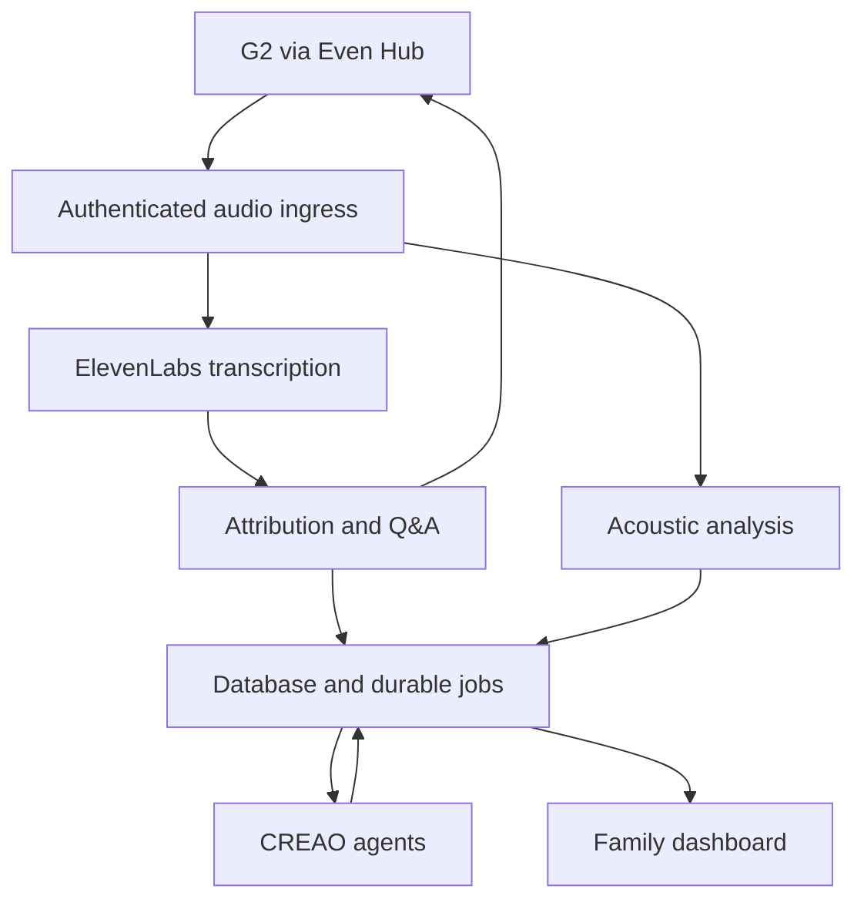

# Asked & Answered / Rewind — MVP implementation spec

Version 3.0 · 17 October 2026 · Concise edition

## 1. Scope

Implement every product feature in the repository's Markdown plans, plus voice-based emotion estimation. **Even Realities G2 supplies audio; ElevenLabs Scribe supplies live transcription.** Patterns and reminders are required, including features previously marked “should have” or “stretch.” The nine additional dementia-support modules are specified in `FULL_PRODUCT_SPEC.md`.

Inspect the current checkout and `AGENTS.md`, preserve working code, and track requirements against implementation and tests. Report missing credentials or hardware verification explicitly; mocks do not count as live integration.

Baseline: [nam-m/la-ai-hackathon-2026](https://github.com/nam-m/la-ai-hackathon-2026). Read `Build Guide.md`, `LA Hacks Team Plan.md`, `folder-structure.md`, `README.md`, `Part 4 - Pipeline Plan.md` and `glasses-app/README.md`, plus any new Markdown requirements. Inspected branch commits:

| Branch | Commit prefix |
|---|---|
| main | `19b94c84c9a1` |
| glasses-app | `5018c6a4c572` |
| part4-pipeline-plan | `a73f18744c89` |
| feat/creao-00-plan | `b37bf8bca0ce` |
| feat/creao-01-contracts | `764c5fc72182` |

Resolve conflicts using current user instructions, this spec and verified platform behavior. Preserve the existing provider seams and development tools.

## 2. Required features

| Area | Requirements |
|---|---|
| Glasses and phone | G2 pairing, mic permission/capture, quiet display, phone mirror/status, pause/resume, recall, offline recovery and system exit |
| Speech | ElevenLabs realtime transcription; wearer/other/unknown attribution; calibrated device hints; timestamped utterances |
| Memory | Question detection, answer capture within 30 seconds, durable records, embeddings and semantic verification, exact sourced recall |
| Family input | Facts create/edit/delete, standing facts, expiry, daily plans and visitors, immediate synchronization |
| CREAO | Three runtime agents: log/summary, patterns and reminder preparation; five-minute logs, daily summary and nightly patterns |
| Reminders | Family-entered schedules, reliable timed delivery, cancellation, quiet hours and missed/expired states |
| Dashboard | Today, Facts, Conversation log, Summary, Patterns, Reminders, Voice cues and Settings; loading/empty/stale/error states |
| Voice cues | Actual acoustic analysis, wearer attribution, uncertainty, timeline, correction and disable controls |
| Delivery | Authentication, consent, retention/deletion, observability, mock/replay tools, packaging, real-device tests and demo runbook |

## 3. Architecture and contracts

Use the existing TypeScript client, Node/Express/WebSocket server, SQLite with migrations/WAL on persistent storage, and CREAO dashboard/runtime integrations. Separate audio consumers so emotion or background-job failures cannot delay Q&A.

Keep server-side provider keys. Use short-lived socket tickets and household/person authorization. Validate full nested payloads; TypeScript casts are not runtime validation.

Retain v1 hello/control/ping, raw PCM and answer/clear/status/pong/error compatibility. For metadata-preserving v2, negotiate version once, return `ready`, and send PCM with stream ID, sequence, source sample offset, count, role hint and playback flag. Define the shared binary schema before changing either endpoint; reject malformed, duplicate or backward frames. Never infer capture time from network arrival.

Audio: signed 16-bit little-endian, 16 kHz mono; approximately 100 ms packets. Bound each live queue to two seconds. Record gaps and restart delayed consumers rather than replaying stale audio. Preserve silence needed for provider VAD. Map provider timestamps back to source samples; uncertain alignment prevents confident attribution.

## 4. Glasses and transcription

Create the G2 page before starting its microphone. Pause/exit disables forwarding immediately, closes provider streams and requests microphone shutdown. Handle a late mic-start result by shutting it down again. Recovery never overrides a deliberate pause.

Preserve current gestures: tap dismiss/retry mic, swipe up recall, long press pause/resume, double tap system exit. Blank display by default; clear an answer after eight seconds. Show source/time and use a reviewed short answer or companion fallback when content does not fit. Never truncate a negation or instruction. Handle unsupported glyphs explicitly.

Use `scribe_v2_realtime`; only committed text enters matching. Keep exact transcript text. Deduplicate later timestamp enrichment. Normalize utterances with IDs, person/session/stream scope, text, source sample ranges, timing quality, role/method, optional speaker identity and overlap status.

Device `speakerRole`/direction are hints, not verified identities. Evaluate wearer and companion turns on actual G2 hardware; loudness alone is insufficient. Unknown/overlapping turns abstain or use an explicitly selected wearer-controlled mode. Preserve fake and operator-selected Deepgram adapters, but demonstrate ElevenLabs for live acceptance.

Retain debug recording/WAV replay, mock server, seed facts and simulator tools; disable recording/debug routes in production. Verify manifest, whitelist, CORS, `.ehpk` packaging and installed Beta behavior after five minutes of phone lock. Reconnect with 1/2/4/10-second backoff and preserve the existing heartbeat.

## 5. Memory and reminders

1. Detect a committed wearer question and immediately search eligible records.
2. Open a 30-second answer window. Accept only an attributable, relevant other-speaker response; reject overlap, unrelated replies and ambiguity.
3. Automatically retain consented low-risk exchanges as observed speech. Send ambiguous/sensitive candidates for review. Keep family-confirmed facts distinguishable.
4. Filter by household/person, permission, validity and supersession before embedding retrieval. A structured verifier accepts/rejects candidates; it cannot rewrite answers.
5. Return one verbatim answer per question with source/time. Recheck expiry/version at delivery. Respect explicit supersession; otherwise use the newest eligible spoken answer, then family facts. Abstain on unresolved contradictions.
6. Expire ordinary spoken records at local midnight or an earlier explicit time. Standing facts have review dates. Deletion/update invalidates retrieval and recall immediately.

Count repeat question events separately from stored answers. Medication reminders may repeat exact family-entered schedules; never infer ingestion or generate dosing advice.

Reminder states: draft, scheduled, due, sent, acknowledged, cancelled, expired or failed. Acknowledgment is a display interaction, not task completion. Persist occurrence IDs, UTC instants and IANA zones; resolve DST ambiguity explicitly. Default delivery window: five minutes, then mark missed. Pause/quiet hours suppress delivery; reconnect never releases a stale backlog.

## 6. Voice-emotion estimation

Call the feature **Voice cues: estimated expression in the wearer’s voice**. It is optional and must analyze original audio. Text sentiment, loudness rules and random labels do not satisfy acceptance.

**ElevenLabs-first check:** Expressive Mode uses acoustic cues, but the reviewed documentation does not establish an exposed standalone live emotion-score API. Its sentiment analysis uses completed transcripts. Verify an accessible structured acoustic event, timing, speaker attribution and score meaning before selecting it for dashboard tracking. Agent-generated interpretations are not calibrated measurements.

If unavailable, use a documented acoustic provider such as Hume through an `EmotionProvider` adapter. Keep ElevenLabs transcription. Missing provider access is a reported integration blocker, not permission to substitute transcript sentiment.

Store provider/model, measurement ID, source ranges, allowed expressions/attributes, score semantics, quality/status and observation time. Apply consent, attribution, overlap, clipping/noise and minimum-speech checks before labeling. Initial hypotheses: ≥1.5 seconds wearer speech, ≥95% wearer coverage and no overlap; validate these rather than presenting them as clinical thresholds.

Allow interest, amusement, joy, frustration, sadness and concern; calm may be a separate voice attribute. Preserve provider score meaning, evaluate labels independently and avoid a forced single winning emotion. Empty/uncertain results are valid. Overlapping windows are not independent evidence. Mark live cues stale after 30 seconds without eligible speech.

Show cues only on authorized companion/dashboard views, with corrections and disable controls. Separate self-report from model estimates. Do not alter factual answers, treatment or medication schedules, or send external alerts based solely on voice cues.

## 7. CREAO, storage and APIs

The server owns five-minute log jobs, the default 20:00 local summary, nightly patterns and reminder timing. CREAO prepares structured results asynchronously. Preserve upload/clip support; use sourced ElevenLabs transcripts when audio input is unsupported. Verify actual account capabilities, limits and model configuration.

Persist a submission intent before calling CREAO, bind its returned run ID afterward and reconcile early callbacks. Authenticate callbacks or retrieve results through the authenticated API. Durably store delivery IDs before acknowledging; deduplicate results, validate complete schemas and reconcile ambiguous timeouts before retrying. Patterns include sources and recording coverage; insufficient data produces no invented trend. Unknown speakers remain unnamed.

Persist sessions, utterances, Q&A/facts/embeddings, occurrence events, plans/visits, reminders/deliveries, logs/summaries/patterns, acoustic observations/feedback, jobs/runs/webhooks, memberships, consents and audit records. Scope every personal row and version mutable content.

Retain `/ws`, `POST /facts`, `DELETE /facts/:id`, `GET /qa/today`, `POST /creao/webhook` and health/readiness routes. Add authenticated dashboard/SSE, plan, reminder, voice-feedback, consent, deletion and manual-summary routes. Mount canonical routes correctly: mounting `/facts` under `/creao` changes its URL. Use mutation idempotency keys, optimistic concurrency, pagination and saved/pending/failed UI states.

## 8. Privacy and failure behavior

Separate consent for transcription, retained logs/clips, acoustic analysis and sharing with named supporters. Explain downstream processing; filtering other speakers afterward does not prevent their audio being processed. Revoke affected streams/jobs/results by consent version.

Use TLS, protected sessions, CSRF/origin checks and rate limits. Treat transcripts/provider output as untrusted. No secrets or private content in logs. Proposed pilot defaults: raw audio in bounded memory; opted-in clips removed after processing or 24 hours; transcripts/voice observations retained seven days. Facts follow their validity/review policy. Verify provider retention separately. Deletion covers derivatives, embeddings and pending jobs.

Q&A continues during emotion/CREAO outages. Unknown speakers and matcher timeouts cause abstention. Database failure must never show a false saved state. Track gaps, latency, queue age, provider failures, cost and stale content without private payloads.

## 9. Build order and acceptance

Build contracts/store/auth → real G2/ElevenLabs → memory/facts/display → acoustic adapter → CREAO jobs → dashboard/patterns/reminders → privacy/recovery → packaging/demo.

Required acceptance evidence:

- Real G2 new question/answer/repeat produces one correct sourced response; reject look-alikes, unrelated replies and overlap. Retain 20 match/10 non-match fixtures.
- Edits, deletion, midnight and explicit expiry invalidate old answers; standing facts remain eligible correctly.
- Pause/start races, gestures, system exit, mic stalls, reconnect and locked-phone Beta behavior work on hardware.
- Three consecutive five-minute logs, daily summary, two-day patterns and insufficient-data cases work unattended.
- Fact/visitor edits synchronize; reminder edit/cancel/restart/offline/DST cases yield one timely delivery or a missed state.
- Forged/duplicate/early callbacks, malformed output, rate limits and ambiguous submissions cannot corrupt records or duplicate visible outcomes.
- Identical words with different delivery exercise actual acoustic analysis; silence, poor audio, other speakers and playback abstain appropriately; stale cues expire.
- Emotion outage leaves Q&A working; revocation stops sharing; household isolation and deletion are verified.
- Long text/glyph handling preserves meaning; app playback never becomes a family answer; client bundles/logs contain no secrets.

Measure the original two-second Q&A target on real hardware; report median/p95 and sample count. Measure acoustic window duration separately. Deliver working code, migrations, requirement/test matrix, provider-capability record, setup/runbook, demo and explicit remaining blockers.

## References

- [ElevenLabs realtime API](https://elevenlabs.io/docs/api-reference/speech-to-text/v-1-speech-to-text-realtime)
- [Expressive Mode](https://elevenlabs.io/docs/eleven-agents/customization/voice/expressive-mode) · [Sentiment analysis](https://elevenlabs.io/docs/eleven-agents/customization/agent-analysis/sentiment-analysis)
- [Hume realtime audio](https://dev.hume.ai/expression-measurement/docs/audio/realtime) · [Score semantics](https://dev.hume.ai/expression-measurement/docs/scores)
- [Even Hub device APIs](https://hub.evenrealities.com/docs/build/device-apis)

Vendor behavior must be verified during implementation. Thresholds and budgets above are engineering proposals, not clinical guarantees.
