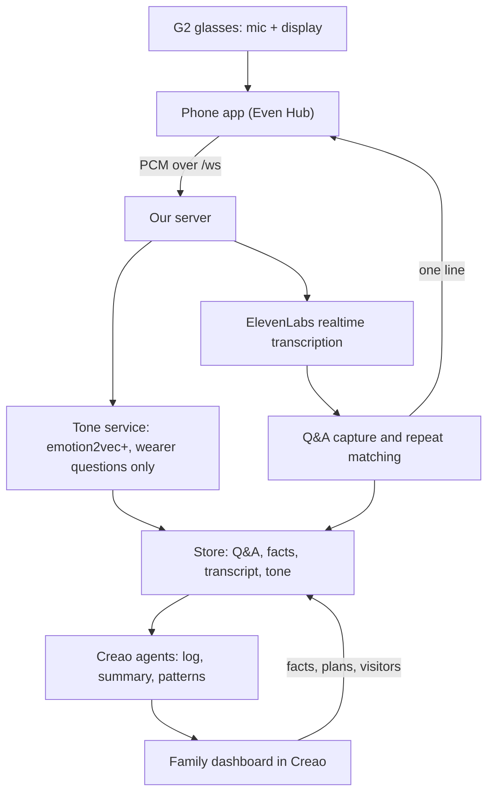

# Asked & Answered / Rewind — MVP implementation spec

Version 4.1 · 17 October 2026 · Hackathon edition (corrects v3.0; tone uses emotion2vec+)

## 1. Scope

Build what can be demoed on a real Even G2 by **feature freeze, Sunday 9:30 AM**. Submissions close at noon.

The product: G2 glasses quietly answer the questions a person with early dementia keeps repeating, using answers their family already gave. The family sees what happened through a Creao dashboard, including the estimated tone of the wearer's voice.

**In scope (must work in the demo)**

1. G2 audio → live transcription → question and answer capture → repeat matching with a yes/no check → one sourced line on the glasses.
2. Family facts, today's plan and visitors entered in the Creao dashboard and used as fallback answers.
3. Voice tone: estimated tone of each wearer question, using the open-source emotion2vec+ model in our own Python tone service.
4. Creao agents: log, daily summary and patterns, built from the transcript **and** tone estimates.
5. Pause, gestures, system exit and recovery after a five-minute phone lock.

**Stretch, in this order, only if 1–5 work on hardware:** wearing and battery alert → reminders (simple version) → patterns over seeded history.

**Out of scope for the hackathon:** see section 10. These go in the Devpost as future work.

Each person reads the build guide for their part; this spec changes it where noted.

## 2. Corrections from v3.0

| v3.0 said | Problem | v4.0 |
| --- | --- | --- |
| ElevenLabs required, loudness insufficient | ElevenLabs realtime has no speaker labels, so with no loudness there is no way to find the wearer | ElevenLabs Realtime with calibrated loudness, abstain when unsure. Deepgram with speaker labels stays a switchable fallback |
| Device `speakerRole`/direction hints | Not in the Even SDK docs: audio events carry only the PCM and the source (glasses or phone) | Removed. Ask the Even table about mic-array features; don't depend on them |
| Everything required, including stretch | Weeks of work | Must-haves and stretch separated; production items moved to future work |
| Two-day patterns working unattended | Only one day of data exists | Patterns run on seeded history plus today, clearly labeled as demo data |
| Emotion "optional" with an open-ended provider search | Unscoped; Hume needs an approval form | emotion2vec+ (open source) in a Python tone service, wearer questions only, family dashboard only |
| Nine extra modules in another spec | A second project | Future work |
| v2 binary audio protocol | Changes both ends during the hackathon | Keep contract 1 (v1). Raw PCM frames as today |
| SQLite migrations, socket tickets, household auth, CSRF, idempotency, SSE | Production hardening | JSON store and shared secrets. Future work |

## 3. Architecture



Rules that hold everywhere:

- **The live path never waits on the tone service or Creao.** If either is slow or down, answers still reach the glasses.
- **Answers are verbatim.** The matcher and verifier only choose or reject an existing answer. No model writes what the wearer sees.
- **Keys stay on the server.** The phone app holds only the app token.

## 4. Glasses and phone (A)

- Create the G2 startup page before starting the glasses mic. Forward PCM chunks to `/ws` (contract 1).
- Display is blank by default. One line: *answer, speaker, time*, or *answer (told you at time)* without a name. Clear after 8 seconds or on `clear`.
- **Never cut off a negation or instruction when shortening.** If an answer doesn't fit, show the first sentence only if it keeps its meaning; otherwise show "See phone" and the full text on the phone.
- Gestures: tap dismisses, **swipe up recalls the last answer**, long press pauses or resumes, **double tap on the root page is system exit** (Even requirement).
- Pause stops forwarding immediately and stops the mic. Recovery after reconnect never undoes a deliberate pause.
- Reconnect with 1, 2, 4, then 10 second backoff; ping every 15 seconds.
- Verify manifest permissions, network whitelist, CORS, `.ehpk` packaging, and the installed Beta after a five-minute phone lock.

## 5. Speech (B)

- **ElevenLabs Scribe v2 Realtime** for live transcription, chosen by the loudness test. Only final (committed) text goes to matching.
- **Wearer attribution:** RMS loudness per utterance against a threshold calibrated on the real G2 with the wearer and a companion. Result is `wearer`, `other` or `unknown`. Unknown or overlapping speech is never treated as a question or an answer.
- Each utterance carries: ID, text, start and end in milliseconds from session start, RMS, role, and the name if known.
- Keep the `fake` provider for testing and Deepgram as a switchable fallback (`SPEECH_PROVIDER`).
- Keep a rolling audio buffer of the last 60 seconds so the tone module can cut out a wearer question's audio by its start and end times.

## 6. Memory and matching (C)

1. A final wearer question is matched immediately against today's records and family facts.
2. Matching: embeddings and cosine similarity, a strict threshold tuned on the 20 match and 10 non-match fixtures (zero wrong matches first), then a yes/no check by a fast model. Any error or timeout returns nothing.
3. Choose the newest spoken answer, then family facts. If two eligible answers contradict each other, show nothing.
4. Answer window: the next `other` utterance within 30 seconds becomes the answer. Overlapping or unknown speech is rejected.
5. Spoken records expire at local midnight. Family facts can carry an expiry time; standing facts don't expire. Deleting or editing a fact takes effect on the next question.
6. Count each repeat as an event, separately from the stored answer, so summaries can say "asked 4 times".

## 7. Voice tone (C builds, D shows)

Name in the product: **"Estimated tone of voice."** It is never presented as a diagnosis.

**Model:** [emotion2vec+](https://huggingface.co/emotion2vec/emotion2vec_plus_base) (open source, no approval needed), run in `tone-service/` (Python, FastAPI, FunASR). Base size on a CPU; large only with a GPU. Labels: angry, disgusted, fearful, happy, neutral, other, sad, surprised. This also qualifies for veri.studio's "Best use of an Open-sourced model."

**Pipeline**

1. The server keeps the last 60 seconds of PCM per session. When a wearer question is final, it cuts the question's audio by the utterance's start and end times (milliseconds since the session's first audio byte).
2. Skip it if the clip is under 1 second or near-silent (below −45 dBFS). Trim to 8 seconds.
3. Wrap as 16 kHz mono WAV and `POST` it to the tone service's `/tone` with the `X-Tone-Secret` header.
4. Store all label scores, the top three, and **worry = fearful + sad** (0 to 1), linked to the question event.
5. Runs in parallel with matching. A tone failure stores a `failed` record and never delays the answer.

**Tone record**

```json
{"id":"tone_42","questionEventId":"qe_17","at":"2026-10-18T14:05:11-07:00","provider":"emotion2vec/emotion2vec_plus_base","scores":{"fearful":0.48,"sad":0.14,"neutral":0.22},"top":["fearful","neutral","sad"],"worry":0.62,"quality":"ok"}
```

`quality` is `ok`, `too_short`, `too_quiet` or `failed`. Empty or uncertain results are valid.

**Rules**

- Wearer's own questions only. Other people's voices are never analyzed.
- Shown on the family dashboard only, never on the glasses. It never changes an answer.
- An on/off setting (`POST /settings`); when off, nothing is sent to the tone service.
- **Trends, not absolute scores.** The model is trained largely on acted speech, so compare each question with the wearer's own earlier ones ("more worried than this morning").
- Hosting: on the same machine as the server, on a laptop through a tunnel (ngrok or Cloudflare), or on a Vultr instance. Free tiers with 512 MB of memory are too small.
- Before the demo: record the same question calmly and worriedly on the real G2 and check that worry differs. Keep those clips as backup.

## 8. Creao and the family dashboard (D)

**What the family does and sees**

| The family enters (stored word for word, never rewritten by AI) | The family sees (generated by Creao agents) |
| --- | --- |
| Facts: question, answer, who said it, optional expiry, standing or not | Today's conversation log, labeled wearer or other |
| Today's plan and visitors | Repeated questions with counts and tone trend |
| Tone analysis on or off | Daily summary |
| | Patterns across days |

Family-entered facts go to the server through `POST /facts` exactly as typed. Creao's AI only produces the log, summaries and patterns; it never writes an answer the glasses will show.

**Agents** (the server triggers them; results come back by webhook)

1. **Log:** every 5 minutes, the server sends the new transcript lines, Q&A pairs, repeat events and tone records. The audio clip upload stays as an option but is not required, since ElevenLabs already gives us the transcript.
2. **Daily summary:** at 8 PM local (by hand in the demo). Inputs: the day's transcript, Q&A pairs, repeat counts, tone records and today's plan.
3. **Patterns:** nightly, over the stored days (seeded for the demo). Same inputs across days.

**Summary output**

```json
{
  "date": "2026-10-18",
  "summary": "Rose had a calm morning. After lunch she asked where Mary was 4 times, and her voice sounded more worried each time.",
  "repeatedQuestions": [
    {"question": "Where is Mary?", "count": 4, "answeredBy": ["Sarah", "family fact"], "toneTrend": "rising worry", "times": ["13:10", "13:42", "14:05", "14:31"]}
  ],
  "highlights": ["Leo visited at 4 and Rose was calm"],
  "suggestions": ["A call from Mary in the afternoon may reassure her"],
  "coverage": "Listening 9:00 to 18:30, paused 30 minutes",
  "sources": ["qe_9", "qe_12", "qe_17", "qe_21", "tone_42"]
}
```

**Instructions for every agent:** describe, don't diagnose. Say "sounded worried", never "is depressed" or "is declining". Don't name unknown speakers. If there's too little data, say so instead of inventing a trend. Cite the source record IDs. Suggestions are gentle ideas for the family, never medical advice.

## 9. Contracts (changes to the build guide)

Contracts 1 to 6 in the build guide stay. Additions:

- **Speech module (contract 2):** `startMs` and `endMs` must be measured from the session's first audio byte, because the server cuts tone audio from its own buffer on that clock.
- **Tone module:** `server/src/emotion/index.ts` with `analyzeQuestion(eventId, pcm)`, which never throws. It calls `tone-service` at `TONE_URL`: `POST /tone` (WAV body, `X-Tone-Secret` header) returns `{model, scores, top, seconds, ms}`; `422` means too short.
- **Facts (contract 4):** add optional `expiresAt` (ISO time) to each fact.
- **New endpoints for D, same shared secret:** `GET /log/today` returns `transcript`, `questions` (each with its tone), `repeated` (question, count, times, worry per ask) and `pairs`; `GET` and `POST /settings` with `{"toneAnalysis": true|false}`.
- **Creao module (contract 5):** add `submitLog(batch)`, which takes transcript lines, Q&A pairs, repeat events and tone records.

## 10. Future work (Devpost, not built now)

- SQLite with migrations, household and person authorization, short-lived socket tickets, CSRF and origin checks, rate limits.
- Consent per feature with versioning and revocation; retention and deletion across all derived data.
- Full reminder lifecycle (scheduled, sent, acknowledged, missed), quiet hours, time zone and daylight-saving handling, medication schedules.
- Binary audio protocol v2 with sequence numbers and sample offsets.
- Live dashboard updates, pagination, idempotency keys and optimistic concurrency.
- Corrections to tone estimates by the family, and validation of tone thresholds.
- The additional dementia-support modules in `FULL_PRODUCT_SPEC.md`.

## 11. Build order and timeline

| By | Milestone |
| --- | --- |
| Sat 10 PM | Real G2 audio reaches the server; live transcript logs; facts endpoint working |
| **Sun 1 AM** | **Go/no-go:** a repeated question on the real G2 shows its earlier answer. If not, tone waits until it does |
| Sun 3 AM | Tone records stored for wearer questions; dashboard shows facts and today's log |
| Sun 5 AM | Log and summary agents use transcript and tone; repeated-question view with tone trend |
| Sun 7 AM | Patterns on seeded history; stretch items if time allows |
| **Sun 9:30 AM** | **Feature freeze.** Beta packaged, then everyone on pitch, demo and Devpost |

## 12. Acceptance (what we check before the demo)

- On the real G2: a new question and answer, then a repeat, produce one correct sourced line in about 2 seconds or less. Look-alikes, unrelated replies and other people's questions show nothing. The 20 and 10 fixtures pass with zero wrong matches.
- Editing or deleting a fact changes the next answer; midnight and `expiresAt` expiry work.
- Pause, gestures, system exit and the installed Beta after a five-minute phone lock work on hardware.
- The same question asked calmly and worriedly produces different worry scores; silence and other speakers produce none; turning tone off stops calls to the tone service.
- With the tone service or Creao disconnected, answers still reach the glasses.
- The daily summary mentions repeated questions with counts and tone, cites sources, and makes no diagnosis.
- No API keys in the phone app bundle or the logs.

## References

- [Even Hub device APIs](https://hub.evenrealities.com/docs/build/device-apis)
- [ElevenLabs speech to text](https://elevenlabs.io/docs/overview/capabilities/speech-to-text)
- [emotion2vec+ on Hugging Face](https://huggingface.co/emotion2vec/emotion2vec_plus_base)

Vendor behavior must be confirmed during the build. Thresholds are engineering starting points, not clinical guarantees.
