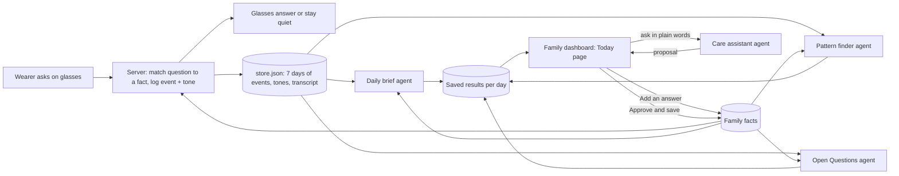

# Agent pipeline: what runs, what triggers what

One page for the team. Status as of Sun 2026-10-18, main after PR #23. For setup and test results see `HANDOFF.md`; for the exact agent specs see `AGENT_SPECS.md`.

## The idea in one paragraph

The glasses answer the wearer's repeated questions live from the family's facts. That live path is fast and does not wait on CREAO. Everything after it is the care side: four CREAO agents read what the wearer asked, work out what it means, and propose something to a person. The server collects the data, starts each agent, saves what comes back, and shows it in the family dashboard. Agents only propose. A person approves, and approval is the only thing that changes what the glasses say.

## Diagram

## Who triggers what

| Agent | CREAO app id | Triggered by | When | Input the server sends | Result saved as | Shown on dashboard |
|---|---|---|---|---|---|---|
| Daily brief | `cc26aad8-308e-4bba-9d1a-164dfed81be5` | Server schedule, or "Generate" button (`POST /creao/summary`) | 20:00 local (`SUMMARY_AT`), once per day | `date`, `data_json` (that day's events + facts) | `Day.summary` | Summary card |
| Pattern finder | `1dd9ddd9-a2a2-491a-a4aa-89f165fd277f` | Server schedule, or "Update now" (`POST /creao/patterns`) | 23:30 local (`PATTERNS_AT`), once per day | `end_date` (today), `data_json` for the last 7 days | `Day.patterns` | Patterns card |
| Open Questions | `44b1a649-026f-4b4f-84f5-1142ba9a2c63` | Server interval, or "Check now" (`POST /creao/open-questions`) | Every `OPEN_QUESTIONS_EVERY_MIN` (30) minutes, only if real new questions arrived | `end_date` (today), `data_json` for the last 7 days | `Day.openQuestions` | Open Questions card |
| Care assistant | `ff8a0dd2-4b8a-454f-a3c5-e231d5c5edd2` | A person, from the Care assistant box (`POST /creao/care`) | On request | `role` (caregiver or clinician), `request`, `today` | Held in memory by run id, read with `GET /creao/care/:runId` | Care assistant card |

No one types an end date or a date. The server fills those in. The dashboard buttons call the same code the schedule does.

## How a run works (same for all four)

1. The server builds `data_json` from its store: `{days:[{date, events}], facts}`. Each event has the question text, the matched fact id, the match score, whether the glasses answered or abstained, and a tone reading (top emotion, a worry flag, quality). Demo events are left out unless `DEMO_DATA=1`.
2. It posts to the agent's own trigger URL with that agent's `CAPI_KEY_*` and gets a run id back.
3. It polls the run every 3 seconds, up to 5 minutes. A run takes about 40 seconds or more.
4. The agent computes every number with code in its sandbox, writes JSON with `schema_version "1.0"`, and the server parses it (it also finds JSON inside a code block in the chat text).
5. The server saves the result and the dashboard picks it up on its next poll (every 15 s on the Today page, every 4 s while a run is open).
6. Only one run per agent at a time. A second start is refused with "already running" (the dashboard says "already working").

## What each agent does

**Daily brief.** Turns one day into a calm recap for the caregiver: how many questions the wearer asked, which were asked more than once, which a family fact answered and which not, and a tone trend for the wearer only. Output: summary, repeatedQuestions, highlights, suggestions, coverage, sources.

**Pattern finder.** Looks across 7 days. Groups questions that mean the same thing and reports the ones that repeat on several days: days seen, total asks, the time-of-day window, and one tone label (more worried, less worried, steady, not enough data). Counts and event ids only. Says "not enough data" rather than guessing.

**Open Questions.** Finds questions the glasses could not answer (abstained, no matching fact) and that came up at least 3 times across at least 2 times of day. Raises at most 3 a day. It never invents an answer; it may only suggest an existing fact's exact text. "Add an answer" on the card opens the Facts form with that question filled in.

**Care assistant.** The one agent a person talks to. Two roles:
- Caregiver: "Sarah is visiting Thursday at 3" becomes a proposed replacement for the matching fact, with the date resolved and a `valid_until`. If the request is unclear it asks one question. It refuses to change settings.
- Clinician (Care team): "count a repeat after 5 asks in 60 minutes" becomes a proposed setting change with a before and after preview of how many repeated-question groups the Daily brief would report. It refuses to edit facts. Preview only.

## Where people stay in control

- Agents never write a fact, change a setting, send a message or publish anything.
- "Approve and save" (dashboard) or `approve-proposal.mjs` (terminal) is the only write. It posts to `POST /facts` as a standing fact that expires at `valid_until`.
- Wording rules sit inside every agent: describe, never diagnose; every claim cites event or fact ids; tone only as a trend across 3 or more observations.

## What is running right now

Running without anyone pressing anything: the summary at 20:00, patterns at 23:30, Open Questions every 30 minutes when there is new data, a 5-minute log stub, and the reminder sender. Nothing runs if the four `CAPI_KEY_*` values are not set on the host; the buttons then show an error.

Not an agent: the live answer on the glasses. That is the server's matcher plus tone detection, and it works with or without CREAO.

## Where it is weak, and how to improve it

Ordered by how much each would help the demo and the judging question ("does the product stop working without the agent?").

1. **Close the loop into the live answer.** Today the glasses keep answering from facts even if CREAO is down. To make the agent central, route the "no match" case through an agent: when the matcher abstains, the server asks Open Questions (or a small new answerer) whether an approved fact or a pending proposal covers it, and the glasses get a calmer, safer fallback. Smaller version: a new fact approved from an Open Question visibly changes the next glasses answer in the demo.
2. **Pass the settings to the agents.** The server saves clinician settings, but the runs only send `date` or `end_date` plus `data_json`. Send `settings_json` (thresholds, tone on or off, ignore topics) so a Care team change actually changes the Daily brief and Pattern finder. Right now a clinician proposal is preview only and nothing applies it.
3. **Send dismissed clusters.** Open Questions accepts `dismissed_clusters`, but the dashboard has no dismiss button and the server does not store dismissals, so a dismissed question can come back.
4. **Agent memory.** Open Questions already has memory fields in its form. Using them (or a notes file per agent) would let each run build on the last instead of re-reading 7 days, and lets the Care assistant remember earlier approved changes.
5. **Persist Care assistant runs.** Care results live in server memory (cap 50), so a restart loses them. Store them with the day.
6. **Worry threshold.** The server marks worry at a tone score of 0.5, a placeholder. Confirm it with whoever owns the tone model, and consider requiring 6 or more observations before the Daily brief says "more worried" (known issue 3 in `HANDOFF.md`).
7. **Failure handling.** A failed or missed run is logged and not retried, because each run costs credits. Add a visible "last run failed, run again" state on the card and a daily credit cap.
8. **Optional second path.** Four hosted v2 agents exist on the developer platform. They are a backup only: they do not appear on agent.creao.ai and cannot run the chat-app agents, so the submission uses the capi trigger path above.

## Quick check that it all works

1. Set `DEMO_DATA=1` and the four `CAPI_KEY_*` values, start the server and the dashboard.
2. Ask "Where is my blue umbrella?" five times. Press "Check now" on Open Questions. The card should show it with count 5.
3. Press "Generate" for the summary and "Update now" for patterns.
4. In the Care assistant box, as Family, ask "Sarah is visiting Thursday at 3 PM". A proposal appears. "Approve and save" and the fact shows in Facts.
5. As Care team, ask for "5 asks in 60 minutes". A before and after preview appears and nothing is applied.
